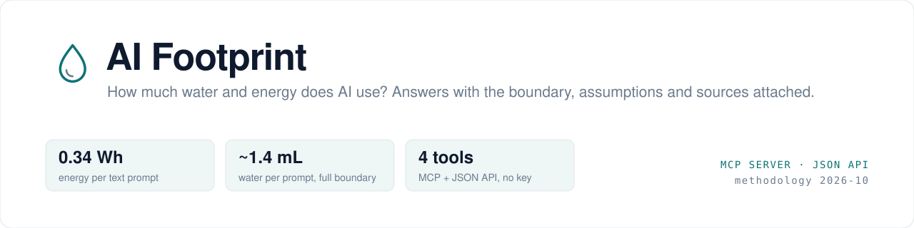
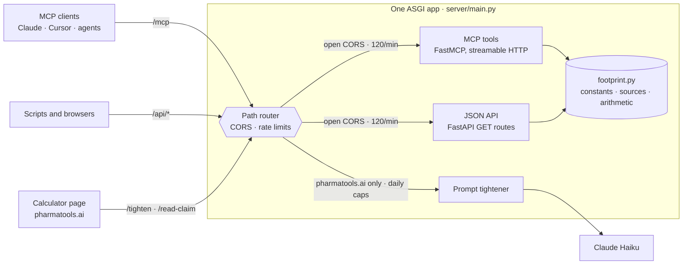

<p align="center">
  <picture>
    <source media="(prefers-color-scheme: dark)" srcset="docs/assets/banner-dark.svg">
    
  </picture>
</p>

<p align="center">
  <a href="https://github.com/nickjlamb/ai-footprint/actions/workflows/ci.yml"></a>
  <a href="https://github.com/nickjlamb/ai-footprint/releases"></a>
  <a href="https://registry.modelcontextprotocol.io/?q=ai-footprint"></a>
  <a href="https://footprint.pharmatools.ai/health"></a>
  
  <a href="https://www.pharmatools.ai/water-consumption-calculator"></a>
  <a href="LICENSE"></a>
</p>

<p align="center">
  <a href="#quick-start">Quick start</a> ·
  <a href="#tools">Tools</a> ·
  <a href="examples">Examples</a> ·
  <a href="#architecture">Architecture</a> ·
  <a href="#methodology">Methodology</a> ·
  <a href="ROADMAP.md">Roadmap</a> ·
  <a href="CONTRIBUTING.md">Contributing</a>
</p>

---

**AI Footprint** is an MCP server and JSON API that estimates the water and energy used by AI: chat prompts, a year of use, or a whole agent session from its token counts. It's the engine behind the [PharmaTools.AI AI Water & Energy Calculator](https://www.pharmatools.ai/water-consumption-calculator), exposed as tools an agent can call.

Published per-prompt estimates of AI water use range from 0.3 mL to 50 mL. Most of that spread is explainable: when the figure was measured, where the accounting boundary is drawn, what kind of workload is counted, and whose data centre it is. So every answer from this server says which boundary it uses, which assumptions it made and which methodology version it comes from. A figure can be checked rather than repeated.

- **Deterministic.** No model in any tool. It's arithmetic over a published, versioned methodology: same input, same answer.
- **Zero setup.** A hosted, read-only endpoint. No API key, no install, no account.
- **Pinned to its source.** The test suite holds the server's outputs identical to the calculator page.

## Quick start

**Under 60 seconds, from any MCP client.** Add the hosted endpoint:

```
https://footprint.pharmatools.ai/mcp
```

**Claude Code**

```bash
claude mcp add --transport http ai-footprint https://footprint.pharmatools.ai/mcp
```

**Claude Desktop and claude.ai:** Settings → Connectors → **Add custom connector**, then paste the URL.

**Cursor** (`~/.cursor/mcp.json`)

```json
{
  "mcpServers": {
    "ai-footprint": { "url": "https://footprint.pharmatools.ai/mcp" }
  }
}
```

**Anything else:** any client that supports remote MCP servers over streamable HTTP. Point it at the URL above.

Then ask:

> *How much water do 30 ChatGPT prompts a day use over a working year?*

```text
estimate_ai_footprint(queries_per_day=30, days=250)

→ 2.6 kWh and 10.5 L over 250 days (comprehensive boundary)
  per prompt: 0.34 Wh, 1.39 mL · about 25.5 hrs of TV or 170 phone charges
  methodology 2026-10 · source: pharmatools.ai/water-consumption-calculator
```

**Not using MCP?** The same tools are plain GET endpoints:

```bash
curl "https://footprint.pharmatools.ai/api/footprint?queries_per_day=30&days=250"
```

## Tools

| Tool | Ask it | Returns |
|---|---|---|
| [`estimate_ai_footprint`](server/mcp_tools.py) | *"30 prompts a day for a year"* | Energy and water per prompt, per day and in total, with everyday equivalents and assumptions. Usage tier `simple` (~0.34 Wh), `mixed` (~1 Wh) or `intensive` (~3 Wh); boundary `onsite` or `comprehensive`. |
| [`estimate_session_footprint`](server/mcp_tools.py) | *"200k input, 3M cached, 40k output tokens"* | A central estimate and a 0.3–3× range for an agent or coding session, plus how many typical chat prompts it equals. |
| [`compare_water_use`](server/mcp_tools.py) | *"Is 500 mL a lot?"* | Teaspoons, bottles and shower time, plus lifecycle items (A4 sheet, almond, tea, burger) with the caveat that those use a much wider boundary. |
| [`get_methodology`](server/mcp_tools.py) | *"Why do estimates vary so much?"* | Per-prompt figures, both boundaries, sources, limitations, a citation line, and four reasons published estimates differ by ~100×. |

All four are annotated read-only, idempotent and closed-world, so clients can tell they're safe to call. More in [`examples/`](examples): a Python MCP client, a dependency-free JavaScript client, `curl` for every endpoint and full captured responses.

## Architecture



- **One source of truth.** [`server/footprint.py`](server/footprint.py) holds every constant, source and calculation. The MCP tools and the JSON API are thin wrappers, so they can't drift apart, and [the tests](server/test_footprint.py) hold both to the calculator page's figures.
- **Two security postures in one app.** The footprint routes are public arithmetic: open CORS, 120 requests per minute per client. `/tighten` spends API credit, so it accepts the calculator page only, behind per-IP and global daily caps. A small ASGI wrapper picks the right policy by path.
- **Stateless.** No database and no sessions. The MCP server runs in stateless JSON-response mode, so any instance can answer any request. Rate limits are in memory, which assumes a single instance (see the [roadmap](ROADMAP.md)).
- **Private by default.** Logs record tool or endpoint names only. Inputs, prompts and IP addresses are not logged.

## Methodology

Energy first, water derived from it.

| | Figure | Basis |
|---|---|---|
| Energy, simple text prompt | ~0.34 Wh | OpenAI's per-query figure; Google reports a median Gemini text prompt at 0.24 Wh (2025) |
| Energy, image or long reasoning | ~3 Wh or more | MIT Technology Review analysis (2025) |
| Water, `onsite` boundary | ~1.0 mL/Wh | Data-centre cooling only, as implied by Google's disclosure. The highest of the published provider figures is used. |
| Water, `comprehensive` boundary | ~4.1 mL/Wh | Adds ~3.1 mL/Wh consumed generating the electricity (US grid average, Li et al.) |
| **Typical text prompt** | **~0.34 mL onsite, ~1.4 mL comprehensive** | The widely quoted 2023 estimates describe hardware that no longer exists |

**Session estimates** are calibrated so ~1,000 input + ~400 output tokens on a frontier model equals one typical prompt (0.34 Wh), with output tokens costing ~5× input and cache reads ~0.1×. These are assumptions, not measurements, so the tool returns a range and says so.

**Limitations.** Vendor figures aren't peer-reviewed, describe median prompts and exclude training. Electricity-generation water uses US grid averages. Results are indicative estimates.

**Sources.** [Google (2025)](https://cloud.google.com/blog/products/infrastructure/measuring-the-environmental-impact-of-ai-inference/) · [OpenAI per-query figures](https://www.datacenterdynamics.com/en/news/sam-altman-chatgpt-queries-consume-034-watt-hours-of-electricity-and-0000085-gallons-of-water/) · [Li et al., *Making AI Less Thirsty*](https://arxiv.org/abs/2304.03271) · [MIT Technology Review (2025)](https://www.technologyreview.com/2025/08/21/1122288/google-gemini-ai-energy/) · [Water Footprint Network](https://www.waterfootprint.org/resources/interactive-tools/product-gallery/)

The full write-up is on the [calculator page](https://www.pharmatools.ai/water-consumption-calculator). When the methodology changes, `METHODOLOGY_VERSION` is bumped and the change is recorded in the [changelog](CHANGELOG.md). Found a better source? [Open a methodology issue](https://github.com/nickjlamb/ai-footprint/issues/new?template=methodology.yml).

## JSON API

The same four tools as GET endpoints with open CORS. `GET /api` lists them.

| Endpoint | Parameters |
|---|---|
| `/api/footprint` | `queries_per_day` (required), `usage=simple\|mixed\|intensive`, `boundary=onsite\|comprehensive`, `days` |
| `/api/session` | `input_tokens`, `output_tokens` (required), `cached_input_tokens`, `model_class=small\|frontier\|reasoning`, `boundary` |
| `/api/compare` | `water_ml` (required) |
| `/api/methodology` | none |

Invalid input returns `400` with a message saying what's allowed. Responses are cacheable for an hour. The limit is 120 requests per minute per client.

## Self-hosting

```bash
git clone https://github.com/nickjlamb/ai-footprint && cd ai-footprint/server
pip install -r requirements.txt
MOCK=1 uvicorn main:app --port 8000
# MCP at http://localhost:8000/mcp · JSON API at http://localhost:8000/api
```

`MOCK=1` makes the tightener return a canned rewrite, so no Anthropic key is needed. The footprint tools don't use a key either way. The included `Procfile` runs as is on Railway, Render, Heroku and similar platforms.

<details>
<summary><b>Configuration</b></summary>

| Variable | Default | Purpose |
|---|---|---|
| `ANTHROPIC_API_KEY` | none | Required for `/tighten` unless `MOCK=1` |
| `MOCK` | unset | `1` returns a canned tightener response |
| `MODEL` | `claude-haiku-4-5` | Model for the tightener |
| `ALLOWED_ORIGINS` | `https://www.pharmatools.ai,https://pharmatools.ai` | CORS allowlist for `/tighten` |
| `PER_IP_PER_MIN` / `PER_IP_PER_DAY` | `4` / `25` | Tightener per-client limits |
| `GLOBAL_PER_DAY` | `1500` | Tightener daily cap across all clients |
| `MAX_INPUT_CHARS` | `1500` | Tightener input cap |
| `PUBLIC_PER_IP_PER_MIN` | `120` | Limit for `/mcp` and `/api/*` |
| `DOCS_URL` | `https://www.pharmatools.ai/mcp#footprint` | Where `/` redirects |
| `PROXY_ENTRIES` | `1` | How many entries your hosting proxy adds to the right of `X-Forwarded-For` (Railway: 1). Rate limits use the entry just before them; anything further left is ignored |

</details>

## Also in this repo: the prompt tightener

`POST /tighten` powers the "Make your first prompt the only one" tool on the calculator page. It sends a draft prompt to Claude Haiku, which rewrites it to get a usable answer first time, filling gaps with `[placeholders]` rather than invented facts. The page then shows what the rewrite itself cost in water against the follow-ups it should save. Unlike the footprint tools it calls a model, so it's locked down: pharmatools.ai-only CORS, a 1,500-character input cap, per-IP and daily caps, forced tool output and no prompt logging. The page embed is in [`web/prompt-tightener-embed.html`](web/prompt-tightener-embed.html).

`POST /read-claim` backs the headline checker on the same page. The page reads well-known claims and simple figures itself, in the browser. Only when it can't, and the visitor chooses to, it sends the claim here. The model just extracts what the claim states (amount, unit, what it's per), and the page explains it with fixed rules. It has the same protections as `/tighten`.

## Development

```bash
cd server
pip install -r requirements.txt -r requirements-dev.txt
MOCK=1 python -m pytest -q      # tests, including parity with the calculator page
ruff check ..                   # lint
```

CI runs lint and tests on Python 3.10 to 3.13, then starts the server and drives it end to end with the [MCP client example](examples/mcp_client.py). Pushing a `v*` tag publishes a GitHub release with notes taken from the [changelog](CHANGELOG.md).

```
server/
  footprint.py        constants, methodology and arithmetic (single source of truth)
  mcp_tools.py        the four MCP tools
  main.py             ASGI app: /mcp, /api/*, /tighten, /read-claim, CORS and rate limits
  test_footprint.py   parity, validation and HTTP tests
examples/             MCP client, JS and curl examples, captured outputs
web/                  calculator-page embed for the tightener
server.json           MCP Registry entry
```

## Privacy

The hosted server keeps no record of what you ask. Its logs contain the name of the tool or endpoint called, nothing else: no inputs, prompts or IP addresses. Client IP addresses are held in memory only to enforce rate limits. They are never logged or written to disk, and are discarded when the server restarts. There's no database and no account. The server runs on [Railway](https://railway.com), and nothing is shared with anyone else. Full policy: [pharmatools.ai/privacy-policy](https://www.pharmatools.ai/privacy-policy#ai-footprint). Questions: info@pharmatools.ai.

## Contributing

Issues and pull requests are welcome, particularly better sources. Read [CONTRIBUTING.md](CONTRIBUTING.md) first: changes to the figures follow a short methodology process so the server and the calculator page stay in step. Security issues go through [SECURITY.md](SECURITY.md), not public issues.

## Embed the calculator on your site

One line, no account or key. It works on any site that accepts a script tag, including WordPress, Webflow, Squarespace and Ghost.

```html
<script src="https://footprint.pharmatools.ai/widget.js" data-theme="auto" data-prompts="25" data-mix="text" async></script>
```

Options: `data-theme` (`light`, `dark`, `auto`), `data-accent` (a hex colour such as `0d7377`), `data-prompts` (1–200), `data-mix` (`text`, `mixed`, `intensive`) and `data-basis` (`comprehensive`, `onsite`). Where scripts aren't allowed, use the iframe directly:

```html
<iframe src="https://footprint.pharmatools.ai/widget?theme=auto&prompts=25" title="AI water and energy calculator" width="100%" height="560" style="border:0;max-width:640px" loading="lazy"></iframe>
```

The widget uses the same figures and methodology version as the API, computes everything in the visitor's browser and sets no cookies. The calculator page has a builder with a live preview.

## Citing

> Lamb, N. (2026). An energy-first method for estimating the water and energy footprint of AI use (methodology 2026-10) [Preprint]. Zenodo. https://doi.org/10.5281/zenodo.23375361

GitHub's **Cite this repository** button gives the software citation from [CITATION.cff](CITATION.cff).

## License

[MIT](LICENSE) © [PharmaTools.AI](https://www.pharmatools.ai)
